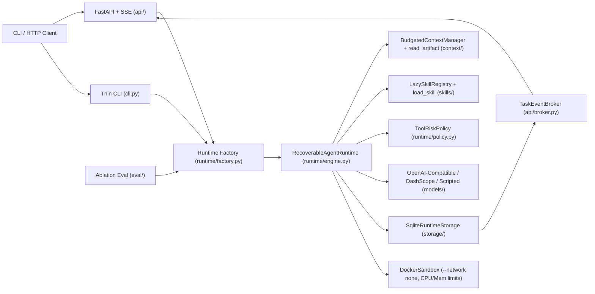

# MiniCode

**MiniCode** 是一个从零构建、强类型、可恢复、沙箱隔离的生产级 **AI Coding Agent Runtime**。

技术栈：`Python 3.12` · `FastAPI` · `SSE` · `Docker Sandbox` · `SQLite` · `Pydantic v2` · `Pytest` · `mypy --strict`

---

## 核心特性

1. **SQLite 原子账本与跨进程断点恢复（`storage/` + `runtime/`）**
   - 使用 SQLite WAL 模式与显式 `BEGIN IMMEDIATE` / `COMMIT` / `ROLLBACK` 事务，保证每步推理、工具执行与状态快照原子落盘（记录 `session_id`、`step`、`sequence`、`event_type`、`payload`、`timestamp`、`token_usage`）。
   - 支持进程崩溃重启后通过 `resume(session_id)` 从最近 Checkpoint 精准续跑，不重复执行已完成步骤。
   - 工具按风险等级分类（`READ_ONLY` / `WRITE_FILE` / `EXECUTE_SHELL`）；命中高危工具时自动挂起并落盘为 `WAITING_APPROVAL`，支持外部传入 `approve` / `reject` 后继续或安全中止。
   - 提供纯只读 `replay(session_id)` 按时间线重建可审计执行轨迹。

2. **预算驱动双视图上下文管理（`context/`）**
   - 严格分离 **Full History**（完整保留于 SQLite Ledger 与 Checkpoint）与 **Model Visible View**（发给 LLM 前动态投影）。
   - 超出 `max_context_tokens` 预算时，保留最近工具输出，优先将较早且体积较大的旧工具输出替换为紧凑占位符：`[Ref: event_id=12, tool=read_file, summary="..."]`。
   - 内置只读工具 `read_artifact(event_id, offset_chars=0, max_chars=None)`，支持按会话隔离精确回读原始内容。

3. **Docker 容器沙箱与 FastAPI + SSE 异步服务（`sandbox/` + `api/`）**
   - `DockerSandbox` 为每个任务会话启动独立容器挂载工作区，强制施加 `--cpus`、`--memory`、`--memory-swap`、`--pids-limit`、`--network none`、`--security-opt no-new-privileges:true` 与命令超时限制，任务结束或异常时自动 `docker rm -f` 清理。
   - 代码修改与测试执行类工具全部路由至沙箱容器内执行。
   - 通过 FastAPI + `asyncio.Task` + `TaskEventBroker`（`asyncio.Queue`）解耦 Agent 执行与 SSE 实时流式推送。

4. **Skill 按需路由与自动化消融评测（`skills/` + `eval/`）**
   - Skill 文件（`skills/*.md`）拆分为轻量级 Frontmatter 元数据与完整策略正文；系统提示词默认仅注入元数据，Agent 可通过 `load_skill(name)` 按需加载正文，显著降低无效 Prompt 占用。
   - 内置 4 个多文件 Python 故障基准场景（跨文件逻辑 Bug、循环导入、分页边界条件、异步并发数据竞争）与独立 Pytest 验收脚本，支持通过 `eval/run_eval.py` 运行多组消融对照实验并输出 Markdown/JSON 报告与轨迹归档。

---

## 系统架构



---

## 项目结构

```text
.
├── skills/                      # 独立 Skill Markdown（metadata + instructions 正文）
│   ├── debug_pytest.md
│   ├── fix_imports.md
│   └── refactor_python.md
├── eval/
│   ├── benchmarks/              # 4 个多文件故障基准场景 + 独立 verify_test.py
│   └── run_eval.py              # 自动化消融评测 CLI 入口
├── src/minicode/
│   ├── schemas/                 # 统一 Pydantic v2 强类型协议（messages/events/checkpoints/api）
│   ├── storage/                 # SQLite 原子事务存储（database/event_ledger/checkpoint_store/store）
│   ├── runtime/                 # 可恢复执行引擎（engine/policy/replay/factory/workspace）
│   ├── context/                 # 预算驱动双视图上下文（manager/tokenizer/read_artifact）
│   ├── sandbox/                 # Docker 隔离沙盒与路由工具（base/docker/tools）
│   ├── skills/                  # Skill 懒加载与按需路由（lazy.py）
│   ├── api/                     # FastAPI + SSE 服务层（app/service/broker）
│   ├── eval/                    # 消融评测引擎（schemas/runner/scripted）
│   ├── models/                  # LLM 适配器（base/openai_compatible/dashscope/scripted）
│   ├── tools/                   # 基础工具协议与工作区编码工具
│   └── cli.py                   # 统一 CLI 入口（run/resume/approve/replay/serve）
└── tests/                       # 覆盖存储、恢复、上下文、沙箱、SSE、Skill 与评测的 Pytest 套件
```

---

## 快速开始

### 1. 安装依赖

```bash
uv sync
```

### 2. 配置模型环境变量

```bash
export DASHSCOPE_API_KEY="your-api-key"
export DASHSCOPE_MODEL="qwen3.7-flash"   # 可选，默认 qwen3.7-flash
```

### 3. CLI 使用

```bash
# 启动新的持久化编码会话（可选传入 --skills-dir skills 启用 Skill 按需加载）
uv run minicode --skills-dir skills run "检查仓库测试并修复失败用例"

# 高危工具挂起后审批继续（或 --decision reject 中止）
uv run minicode approve <session_id> --decision approve --reason "已确认修改范围"

# 进程中断重启后从最近 Checkpoint 断点恢复
uv run minicode resume <session_id>

# 只读审计轨迹回放
uv run minicode replay <session_id>
```

### 4. 启动 FastAPI + SSE 服务

```bash
export MINICODE_WORKSPACE="$(pwd)"
export MINICODE_SANDBOX_IMAGE="python:3.12-slim"

uv run uvicorn minicode.api.app:create_default_app --factory --host 0.0.0.0 --port 8000
# 或直接通过 CLI 启动：
# uv run minicode serve --host 0.0.0.0 --port 8000
```

#### `curl` 接口测试示例

```bash
# 1. 创建异步编码任务（返回 202 Accepted）
curl -s -X POST http://127.0.0.1:8000/tasks \
  -H "Content-Type: application/json" \
  -d '{
    "task": "检查仓库测试并修复失败用例",
    "session_id": "demo_task_001",
    "max_context_tokens": 4096
  }'

# 2. 实时订阅 SSE 事件流（思考 / 工具调用 / 审批请求 / 完成）
curl -N http://127.0.0.1:8000/tasks/demo_task_001/stream

# 3. 高危工具审批（approve / reject）
curl -s -X POST http://127.0.0.1:8000/tasks/demo_task_001/approve \
  -H "Content-Type: application/json" \
  -d '{"decision": "approve", "reason": "已确认代码改动"}'

# 4. 断点恢复
curl -s -X POST http://127.0.0.1:8000/tasks/demo_task_001/resume

# 5. 只读轨迹回放
curl -s http://127.0.0.1:8000/tasks/demo_task_001/replay
```

### 5. 运行消融评测

```bash
# 离线确定性回归验证（自动生成 report.md / report.json 与 traces/）
uv run python eval/run_eval.py --mode scripted

# 接入真实 LLM 运行消融对照实验
uv run python eval/run_eval.py --mode dashscope --output-dir eval/reports/dashscope_run1
```

---

## 质量校验

```bash
uv run pytest -v
uv run mypy
uv run ruff check src eval tests
```
